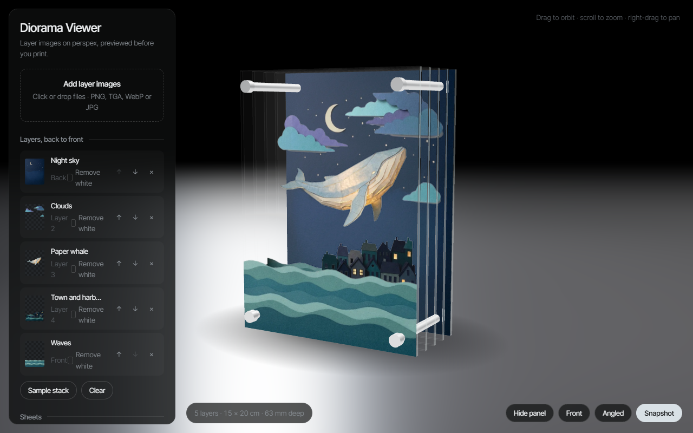
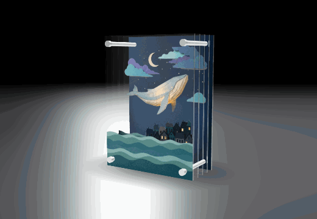

# Diorama Viewer

[](https://github.com/Shirojoufu/diorama-viewer/actions/workflows/ci.yml)



Preview layered shadowbox dioramas in 3D before you print them, then generate the 3D-printable mounts to hold them.

Drop in your layer images, and the viewer stacks each one on a clear perspex sheet you can orbit, zoom and photograph. Pick a mount style and it builds matching STL files sized to your sheets.

It is a single HTML file that runs entirely in the browser: no build step, no server, no account. **[Open it on GitHub Pages](https://shirojoufu.github.io/diorama-viewer/)**.

<p align="center"></p>

## Features

**Layers**
- Any number of layers, ordered back to front, with drag-and-drop and file picking
- Reads PNG, WebP, JPG, GIF, BMP, SVG and TGA (including 15/16/24/32-bit, greyscale and RLE-compressed TGA, which browsers can't normally open)
- Keeps alpha transparency; optional white-background removal per layer, with adjustable strength
- Fit-inside or fill-and-crop placement

**Sheets**
- Sheet width and height, gap between sheets and perspex thickness, all adjustable
- Perspex rendering with glossy faces, tinted polished edges and a clarity slider from crystal-clear to frosted

**Mounts**
- Steel standoffs, L brackets, a full L holder, C brackets or a full slotted surround
- Finishes: black, white or grey PLA, walnut or aluminium
- Adjustable slot depth and clearance

**STL export**
- One-click download of the printable parts for the chosen mount, as a .zip with a README of settings and print tips
- Parts are generated from your current sheet size, thickness, gap and layer count, so the slots match what you see
- Meshes are watertight and slicer-ready, which the test suite checks for every mount type

**Presentation**
- Black, graphite or white backdrop with a spotlight, reflective plinth and contact shadow
- Front and angled views, slow turntable, and PNG snapshots

## Sample stack

The viewer opens with **Paper Whale**, an original five-layer cut-paper scene: night sky, clouds, a glowing paper whale, a seaside town and waves. The layers are stored in [samples/](samples/) as 750 × 1000 WebP files with transparency. Press **Sample stack** to bring it back at any time. If the page is opened straight from disk, where browsers block reading local images, it falls back to a simple stack drawn in code. Serve the folder (`npm run serve`) or use the hosted page to see the whale.

## Use it

Open the [hosted version](https://shirojoufu.github.io/diorama-viewer/), or serve this folder (`npm run serve`) and open it in a modern browser (Chrome, Edge, Firefox or Safari). Opening `index.html` straight from disk also works, but shows the drawn fallback stack instead of the whale.

1. Click **Add layer images** or drop files onto the page. Files are sorted by name, so `1-back.png` … `5-front.png` stack in order.
2. Set the sheet size, gap and thickness to match your perspex.
3. Choose a mount and finish, then **Download STL files (.zip)**.

Exporting layers from Krita: put each layer in its own group, hide any background, then use **Layer → Import/Export → Save Group Layers…** as PNG at full image size.

## How the STL export works

Every mount is described as a list of rectangular blocks in millimetres: base plates, uprights, and ribs with gaps where the sheets sit. The page builds a grid from every block edge, marks each grid cell solid or empty, and emits only the faces where solid meets empty. Because every face lies on the same grid, the mesh is always closed and manifold, with no CSG library needed. The binary STL and the .zip container are written directly in JavaScript.

## Dependencies

[three.js](https://threejs.org) r147 and its OrbitControls and RoomEnvironment add-ons are vendored in [vendor/three/](vendor/three/), unmodified from the `three@0.147.0` npm package, with three.js's MIT [LICENSE](vendor/three/LICENSE). The page needs no CDN. The Inter Tight font still loads from Google Fonts; offline, the page falls back to the system font.

## Development

Requires Node.js 22 or later.

```sh
npm ci                              # Playwright and gifenc, for tests and screenshots only
npm test                            # unit tests
npx playwright install chromium     # once
npm run test:browser                # browser smoke tests
npm run capture                     # regenerate docs/screenshot.png and docs/turntable.gif
npm run serve                       # http://127.0.0.1:4173/
```

**Unit tests** ([tests/unit/](tests/unit/)) use Node's built-in test runner. They load `stlParts`, `meshBoxes`, `stlBinary`, `zipBlob` and `decodeTGA` straight out of `index.html`, so they test the code the page ships.

- *STL*: every mount type at five sheet configurations (smallest to largest sheets, thin and thick perspex, narrow and wide gaps, shallow and deep slots) and 1, 2 and 7 layers. Each mesh must be watertight (every edge shared by exactly two triangles, wound oppositely), have positive, plausible volume and the expected dimensions, before and after the float32 rounding of the binary STL.
- *ZIP*: the exported archive is checked with `unzip -t` (or Python's `zipfile` where `unzip` isn't installed), and every file must round-trip byte for byte.
- *TGA*: generated files for every supported variant (8/16-bit grey, 15/16/24/32-bit colour, raw and RLE, all four origins, ID fields and colour maps), plus files the decoder must reject.

**Browser tests** ([tests/browser/](tests/browser/)) use Playwright with Chromium and software WebGL (SwiftShader). They load the page and fail on any console error or any request to a CDN. Then they add a PNG, JPG, WebP, GIF, BMP, SVG and TGA through the file input, check how unreadable files are reported, and download the STL zip both as a normal browser download and through Claude's downloads API.

Both runners write JUnit XML to `reports/junit/`. The Playwright HTML report goes to `reports/playwright-html/`.

## Engineering

[.github/workflows/ci.yml](.github/workflows/ci.yml) runs the unit and browser tests on every push and pull request, and uploads the JUnit XML and the Playwright report as artifacts. A failed test is retried once: if the retry passes, the test is reported as flaky and the build stays green. On `main`, once both suites pass, the site is deployed to GitHub Pages with `actions/deploy-pages`. Each deploy is recorded as a GitHub Deployment to the `github-pages` environment, with its status.

### Flaky test detection: [Flaky-Tests](https://github.com/Shirojoufu/Flaky-Tests)

The CI's *Flaky test detection* job passes each suite's JUnit XML, including retries, to the Flaky-Tests action, pinned to v0.1.0 by commit. The action keeps every run's results on the `flaky-data` branch. It flags tests that both passed and failed on identical code, rates how severe each flake is, and reports tests that fail every time separately as real failures. Its report goes into the job summary, with `::warning` annotations on flaky failures, and its data is uploaded as a `flaky-report-*` artifact. The latest data from `main` is also kept in `reports/` on the `flaky-data` branch.

This is JavaScript, and the detector's per-test fingerprints need coverage.py data, so each test is fingerprinted by the whole commit tree. Evidence of flakiness therefore comes from retries and repeated runs on the same commit. [Flaky hunt](.github/workflows/flaky-hunt.yml) runs the browser suite five times every Wednesday (or as often as you ask, from the Actions tab) to give it that evidence.

### Delivery metrics: [DORA-Metrics](https://github.com/Shirojoufu/DORA-Metrics)

[DORA report](.github/workflows/dora-report.yml) runs the DORA-Metrics action (pinned to v1.0.1 by commit) against this repo's `github-pages` deployments. It runs after every CI run on `main` and every Monday, and writes the four metrics to the job summary:

- **Deployment frequency**: successful Pages deployments per week
- **Lead time for changes**: from a merged pull request's first commit to the deployment that shipped it. Changes pushed straight to `main` have no pull request and aren't counted, so this needs PRs.
- **Change failure rate**: failed deployments as a share of all finished deployments
- **Recovery time**: from a failed deployment to the next successful one

DORA-Metrics counts failed deployments only. It doesn't read incident issues, so a deploy that succeeded but broke the page isn't counted as a failure.

## Licence

MIT. See [LICENSE](LICENSE). three.js is MIT, © three.js authors: see [vendor/three/LICENSE](vendor/three/LICENSE).
