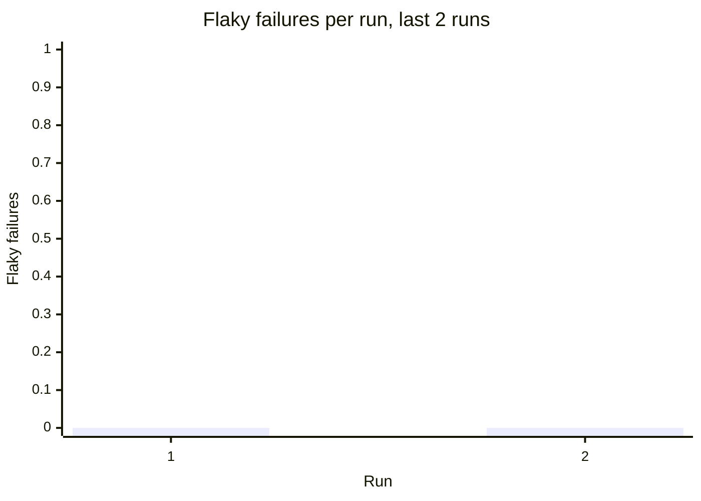

# Flaky test report

**Runs analysed:** 2 (2 on main, 0 from pull requests) · **Tests tracked:** 131 · **Flaky:** 0 (🔴 0 critical, 🟠 0 high, 🟡 0 medium, ⚪ 0 low) · **Consistently failing:** 4 · **Fixed flakes:** 0

## This run

main · commit `ca5a8af` · Add Diorama Viewer with Paper Whale sample, tests, CI and Pages deploy

| Test | Verdict | Severity | Message |
| --- | --- | --- | --- |
| `smoke.spec.mjs."Sample stack" restores the whale after the layers are changed [browser]` | ❌ failure: no evidence of flakiness, likely a real failure |  | expect(locator).toHaveText(expected) failed |
| `smoke.spec.mjs.adds a layer from each supported image format [browser]` | ❌ failure: no evidence of flakiness, likely a real failure |  | Test timeout of 30000ms exceeded. |
| `smoke.spec.mjs.each sample WebP decodes at 750 × 1000, with alpha on every layer but the sky [browser]` | ❌ failure: no evidence of flakiness, likely a real failure |  | Test timeout of 30000ms exceeded. |
| `smoke.spec.mjs.reports files it cannot open and keeps the rest [browser]` | ❌ failure: no evidence of flakiness, likely a real failure |  | Test timeout of 30000ms exceeded. |

## Flaky tests

No flaky tests detected: no test has both passed and failed on the same code.

## Consistently failing tests

These fail on their current code and have never passed on it: likely real breakages, not flakes.

| Test | Failing since | Failures |
| --- | --- | --- |
| `smoke.spec.mjs."Sample stack" restores the whale after the layers are changed [browser]` | `ca5a8af` main 2026-11-24 | 2 |
| `smoke.spec.mjs.adds a layer from each supported image format [browser]` | `ca5a8af` main 2026-11-24 | 2 |
| `smoke.spec.mjs.each sample WebP decodes at 750 × 1000, with alpha on every layer but the sky [browser]` | `ca5a8af` main 2026-11-24 | 2 |
| `smoke.spec.mjs.reports files it cannot open and keeps the rest [browser]` | `ca5a8af` main 2026-11-24 | 2 |

## Trends

```mermaid
xychart-beta
    title "First-attempt pass rate (%), last 2 runs"
    x-axis "Run" [1, 2]
    y-axis "Pass rate" 0 --> 100
    line [100.0, 55.56]
```



<details><summary>Run key</summary>

| Run | Commit | Where | Date |
| --- | --- | --- | --- |
| 1 | `ca5a8af` | main | 2026-11-24 |
| 2 | `ca5a8af` | main | 2026-11-24 |

</details>

## Coverage

No coverage data. Run pytest with `--cov --cov-context=test --cov-report=json`.

## Graph data

- `runs.csv`: one row per run: pass rate, failures, flaky failures, coverage, diff coverage
- `runs.json`: same as runs.csv, as JSON
- `test_outcomes.csv`: every test attempt in every run (long format, for heatmaps)
- `flaky_tests.json`: flaky and failing tests with stats, onset and per-run timeline
- `coverage_files.csv`: per-file coverage for the latest run with coverage
- `coverage_gaps.json`: files below threshold, never-executed files, uncovered changed lines
